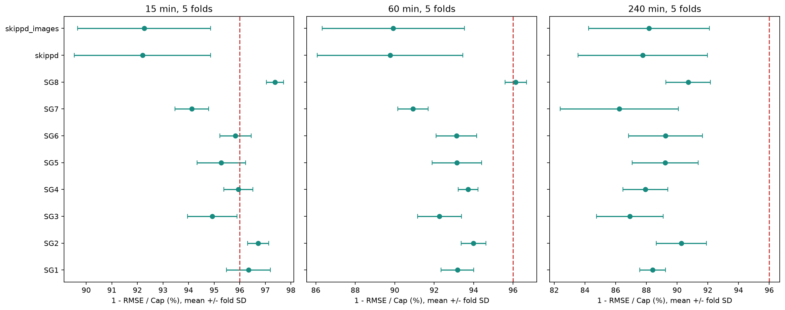

# 五折时序交叉验证与有效样本7:3审计

依据用户明确口径：训练集/测试集比例按有效预测样本数计算。比赛原文未提供，此报告只确认7:3条款及防泄漏约束，不认证比赛全部要求。

## 结论

原发布权重的实验按观测日期60/10/30划分，实际训练只占其中60%日期，验证10%仅用于选型，没有70%最终重拟合；有效样本比例还受白天覆盖/缺测影响。因此原实验不能称为符合严格有效样本7:3。
本轮10个方案曾完成五折CV，并把最终拟合/测试有效样本分成floor(0.7*N)/剩余样本。由于本轮新拟合存在数据泄漏风险，所有CV新训练权重已舍弃，不得部署或用于替换冻结包；下文分数仅作为方法审计记录，不能作为已批准模型成绩。原冻结10份joblib的SHA256前后逐一一致。

八站等权CV均值（先平均五折，再平均电站）：

|   horizon_minutes |   mae_accuracy_pct_mean |   rmse_accuracy_pct_mean |
|------------------:|------------------------:|-------------------------:|
|            15.000 |                  98.169 |                   95.818 |
|            60.000 |                  96.562 |                   93.314 |
|           240.000 |                  93.450 |                   88.619 |

## 旧方案审计

| 方案            |    旧训练 |   旧验证 |   旧测试 |   旧实际拟合/% |   旧训练加验证/% |   旧测试/% |
|:--------------|-------:|------:|------:|----------:|-----------:|--------:|
| state_grid_1  |  41969 |  6929 | 21041 |    60.008 |     69.915 |  30.085 |
| state_grid_2  |  41969 |  6929 | 21041 |    60.008 |     69.915 |  30.085 |
| state_grid_3  |  31409 |  5201 | 15761 |    59.974 |     69.905 |  30.095 |
| state_grid_4  |  41902 |  6795 | 20903 |    60.204 |     69.967 |  30.033 |
| state_grid_5  |  41571 |  6929 | 21041 |    59.779 |     69.743 |  30.257 |
| state_grid_6  |  38554 |  5509 | 18879 |    61.253 |     70.006 |  29.994 |
| state_grid_7  |  38552 |  5511 | 18467 |    61.654 |     70.467 |  29.533 |
| state_grid_8  |  41348 |  6754 | 20595 |    60.189 |     70.021 |  29.979 |
| skippd        | 125013 | 17385 | 74410 |    57.661 |     65.679 |  34.321 |
| skippd_images | 125013 | 17385 | 74410 |    57.661 |     65.679 |  34.321 |

skippd与skippd_images同一数据、两种输入，不是独立电站。旧方案把训练加验证合看也不能掩盖未作70%最终拟合的问题。

## 新有效样本7:3

| 方案            |   训练有效样本 |   测试有效样本 |   训练占比/% |   测试占比/% | 70%整数舍入   |   边界排除样本 |
|:--------------|---------:|---------:|---------:|---------:|:----------|---------:|
| state_grid_1  |    49012 |    21006 |   69.999 |   30.001 | True      |       79 |
| state_grid_2  |    49012 |    21006 |   69.999 |   30.001 | True      |       79 |
| state_grid_3  |    36715 |    15735 |   70.000 |   30.000 | True      |       79 |
| state_grid_4  |    48775 |    20904 |   70.000 |   30.000 | True      |       79 |
| state_grid_5  |    48734 |    20886 |   70.000 |   30.000 | True      |       79 |
| state_grid_6  |    44069 |    18887 |   70.000 |   30.000 | True      |       21 |
| state_grid_7  |    43740 |    18746 |   70.000 |   30.000 | True      |       79 |
| state_grid_8  |    48143 |    20633 |   70.000 |   30.000 | True      |       79 |
| skippd        |   151599 |    64972 |   70.000 |   30.000 | True      |      237 |
| skippd_images |   151599 |    64972 |   70.000 |   30.000 | True      |      237 |

有效样本必须同时满足过去30个连续1分钟点或64个连续15分钟点、15/60/240min精确目标均存在。时序边界前的训练样本最长目标须在边界前；边界后的测试历史全部在边界后。跨边界样本剔除后重新求边界，使训练数=floor(0.7*(训练数+测试数))。边界选择只使用时间和可用性，不读取功率值。表中‘70%整数舍入’表示训练数按该规则取整，比例误差小于一个样本；它不表示总样本数可被10整除的数学精确整数7:3。
比例表比70%可能低不到一个样本；若规则要求数学精确整数7:3（分母必须为10的倍数）而不允许一般整数舍入，需额外确认是否允许移除至多9个样本。本轮未擅自丢弃样本凑整数。原始行比例不必7:3，split_audit.csv保留它。

## 五折方法

前70%有效样本对应的时间前缀为开发集，其余30%隔离为最终测试。开发时间前缀分六个连续块：折1用块1历史评估块2，折2用块1–2评估块3，依次扩展至折5评估块6。折划分按开发前缀原始行进度，外层评估有效样本量可不同。各折保留跨缺测/历史/目标的清除，不随机打散。
每折外层训练前缀内部80%用于拟合七个预先固定的候选，其余20%作为内层验证；验证前60%日期做凸权重/候选选择，后40%日期校准。历史时槽均值与Ridge标准化仅在该折拟合前缀建立，未来实测气象/目标功率不作输入。外层评估只在选型冻结后计算。
这评估的是同一模型族和特征协议的折内重拟合/选型过程，而非用已见过这些历史数据的冻结权重直接预测所得的伪CV。原冻结模型的验证说明不能替换为本轮折模型成绩。七候选和特征方案此前已研究，本轮属于回顾性验证，不能宣称新盲测。
五折标准差为ddof=1的折间变动，不是置信区间；训练前缀重叠、评估季节不同，折不独立。另存样本合并后的OOF MAE/RMSE；合并RMSE不等于折RMSE的简单平均。五折训练/评估比例不是每折7:3，7:3约束用于开发集/最终测试集外层。

## 五折CV指标

| 模型方案          |   时距/min |   CV MAE准确率均值/% |   折标准差/百分点 |   CV RMSE准确率均值/% |   RMSE折标准差/百分点 |   两项达标折比例/% |
|:--------------|---------:|----------------:|-----------:|-----------------:|---------------:|------------:|
| state_grid_1  |       15 |          98.451 |      0.565 |           96.341 |          0.853 |      60.000 |
| state_grid_1  |       60 |          96.474 |      1.099 |           93.177 |          0.828 |       0.000 |
| state_grid_1  |      240 |          93.381 |      1.022 |           88.401 |          0.843 |       0.000 |
| state_grid_2  |       15 |          98.560 |      0.386 |           96.720 |          0.410 |     100.000 |
| state_grid_2  |       60 |          96.819 |      0.691 |           93.992 |          0.626 |       0.000 |
| state_grid_2  |      240 |          94.262 |      1.447 |           90.276 |          1.634 |       0.000 |
| state_grid_3  |       15 |          97.842 |      0.600 |           94.925 |          0.967 |      20.000 |
| state_grid_3  |       60 |          95.978 |      1.010 |           92.272 |          1.115 |       0.000 |
| state_grid_3  |      240 |          91.866 |      2.631 |           86.919 |          2.170 |       0.000 |
| state_grid_4  |       15 |          98.266 |      0.371 |           95.943 |          0.568 |      20.000 |
| state_grid_4  |       60 |          96.930 |      0.582 |           93.722 |          0.496 |       0.000 |
| state_grid_4  |      240 |          93.497 |      1.376 |           87.941 |          1.459 |       0.000 |
| state_grid_5  |       15 |          97.913 |      0.796 |           95.279 |          0.947 |      20.000 |
| state_grid_5  |       60 |          96.345 |      1.752 |           93.154 |          1.259 |       0.000 |
| state_grid_5  |      240 |          93.772 |      1.953 |           89.222 |          2.141 |       0.000 |
| state_grid_6  |       15 |          98.214 |      0.509 |           95.832 |          0.613 |      40.000 |
| state_grid_6  |       60 |          96.645 |      0.834 |           93.127 |          1.031 |       0.000 |
| state_grid_6  |      240 |          93.824 |      1.860 |           89.239 |          2.410 |       0.000 |
| state_grid_7  |       15 |          97.450 |      0.426 |           94.129 |          0.657 |       0.000 |
| state_grid_7  |       60 |          95.391 |      0.532 |           90.928 |          0.773 |       0.000 |
| state_grid_7  |      240 |          92.006 |      2.438 |           86.230 |          3.844 |       0.000 |
| state_grid_8  |       15 |          98.654 |      0.219 |           97.376 |          0.333 |     100.000 |
| state_grid_8  |       60 |          97.913 |      0.307 |           96.138 |          0.537 |      40.000 |
| state_grid_8  |      240 |          94.990 |      0.827 |           90.721 |          1.447 |       0.000 |
| skippd        |       15 |          96.252 |      1.604 |           92.200 |          2.664 |      20.000 |
| skippd        |       60 |          94.224 |      2.285 |           89.764 |          3.692 |       0.000 |
| skippd        |      240 |          91.926 |      3.243 |           87.755 |          4.212 |       0.000 |
| skippd_images |       15 |          96.080 |      1.433 |           92.266 |          2.601 |      20.000 |
| skippd_images |       60 |          94.187 |      2.162 |           89.926 |          3.610 |       0.000 |
| skippd_images |      240 |          92.328 |      2.895 |           88.176 |          3.930 |       0.000 |



cv_summary.csv保留MAE/RMSE的kW均值与标准差、两项准确率、合并OOF指标及达标折比例。fold_metrics.csv给出150个方案/折/时距的原指标和日期边界。

## 70%最终拟合与30%测试

原CV流程曾用五折内层选出的权重算术平均，并在70%开发样本上重拟合；该流程及其新权重现已因潜在数据泄漏风险作废。残差分位数和CV分数仅保留为审计记录，不得用于部署或替换上线包。

| dataset       |   horizon_minutes |     n |   mae_kw |   rmse_kw |   mae_accuracy_pct |   rmse_accuracy_pct | pass_both   |
|:--------------|------------------:|------:|---------:|----------:|-------------------:|--------------------:|:------------|
| state_grid_1  |                15 | 21006 |  668.679 |  1781.846 |             98.663 |              96.436 | True        |
| state_grid_1  |                60 | 21006 | 1432.639 |  3104.471 |             97.135 |              93.791 | False       |
| state_grid_1  |               240 | 21006 | 2631.930 |  4941.827 |             94.736 |              90.116 | False       |
| state_grid_2  |                15 | 21006 | 1621.937 |  4039.252 |             98.752 |              96.893 | True        |
| state_grid_2  |                60 | 21006 | 3380.809 |  7151.996 |             97.399 |              94.498 | False       |
| state_grid_2  |               240 | 21006 | 5742.489 | 10399.835 |             95.583 |              92.000 | False       |
| state_grid_3  |                15 | 15735 |  543.406 |  1355.643 |             98.189 |              95.481 | False       |
| state_grid_3  |                60 | 15735 |  976.133 |  2082.161 |             96.746 |              93.059 | False       |
| state_grid_3  |               240 | 15735 | 1931.868 |  3396.296 |             93.560 |              88.679 | False       |
| state_grid_4  |                15 | 20904 | 2068.787 |  5106.971 |             98.409 |              96.072 | True        |
| state_grid_4  |                60 | 20904 | 3320.422 |  7264.420 |             97.446 |              94.412 | False       |
| state_grid_4  |               240 | 20904 | 6560.742 | 12294.664 |             94.953 |              90.543 | False       |
| state_grid_5  |                15 | 20886 | 1994.600 |  4941.391 |             98.187 |              95.508 | False       |
| state_grid_5  |                60 | 20886 | 3053.875 |  6654.333 |             97.224 |              93.951 | False       |
| state_grid_5  |               240 | 20886 | 5162.458 |  9896.352 |             95.307 |              91.003 | False       |
| state_grid_6  |                15 | 18887 |  581.573 |  1420.116 |             98.338 |              95.943 | False       |
| state_grid_6  |                60 | 18887 | 1048.128 |  2227.972 |             97.005 |              93.634 | False       |
| state_grid_6  |               240 | 18887 | 1780.279 |  3331.503 |             94.913 |              90.481 | False       |
| state_grid_7  |                15 | 18746 |  700.738 |  1707.484 |             97.664 |              94.308 | False       |
| state_grid_7  |                60 | 18746 | 1134.584 |  2374.476 |             96.218 |              92.085 | False       |
| state_grid_7  |               240 | 18746 | 1803.318 |  3392.027 |             93.989 |              88.693 | False       |
| state_grid_8  |                15 | 20633 |  351.963 |   684.988 |             98.827 |              97.717 | True        |
| state_grid_8  |                60 | 20633 |  457.173 |   860.075 |             98.476 |              97.133 | True        |
| state_grid_8  |               240 | 20633 |  902.841 |  1828.580 |             96.991 |              93.905 | False       |
| skippd        |                15 | 64972 |    0.619 |     1.603 |             97.944 |              94.675 | False       |
| skippd        |                60 | 64972 |    0.895 |     1.959 |             97.025 |              93.491 | False       |
| skippd        |               240 | 64972 |    1.136 |     2.050 |             96.227 |              93.188 | False       |
| skippd_images |                15 | 64972 |    0.603 |     1.515 |             97.998 |              94.968 | False       |
| skippd_images |                60 | 64972 |    0.918 |     1.945 |             96.951 |              93.537 | False       |
| skippd_images |               240 | 64972 |    1.263 |     2.157 |             95.806 |              92.834 | False       |

新测试集共有5/30个方案/时距满足两项96%（其中图像/非图像是同站消融，不能当作十站统计）。白天指标与概率区间覆盖见final_test.csv，天气组沿用来源/unknown。
同一原始数据此前已评估，新的7:3时间边界并不能使其成为从未查看的数据。最终测试仅用于本轮固定流程的描述性评估。Cap沿用名义容量，达标不是实际可用容量口径认证。

## 可复现文件

- runs/cv_7030_v1/protocol.json：seed=42、固定七候选、特征/脚本哈希、包版本。
- 每方案fold_1…fold_5：权重、缓存、选型、配置、预测CSV、指标JSON、代码版本。
- 每方案cv_predictions.csv/cv_metrics.json和final_test_predictions.csv/final_test_metrics.json。
- split_audit.json：旧/新比例、清除数量、边界时间及实际拟合样本。
- frozen_models_before.json/after.json：证明发布权重未变；本轮研究权重已删除，未上传。

```bash
DYLD_LIBRARY_PATH="$PWD/.venv/lib/python3.12/site-packages/torch/lib" python -m experiments.cross_validate --dataset all
python -m experiments.report_cross_validation
```

macOS的DYLD路径为本机已安装OpenMP路径示例；其他平台按环境配置。不支持同目录混合改动后的CV协议，调整需要新实验目录。
