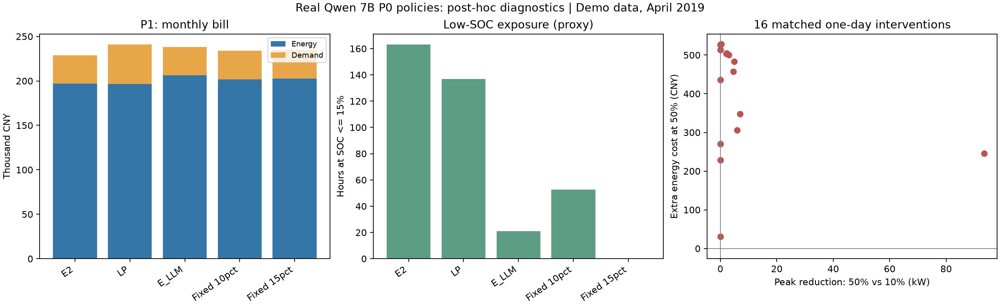

# 真实 LLM 的 P1/P3 补充比较与 50% SOC 储备诊断

## 1. 摘要

**方法：**复用 qwen2.5:7b / local-pilot-v1 在 2019-04-01—2019-04-30（Asia/Shanghai）的封存策略，对同一演示场景做需量结算、预测 LP 比较和固定储备反事实；新增 LLM 调用 0 次，未改提示词、策略、预测或执行器。

**结果：**含需量后，E_LLM 比 E2 多花 9,403.02 元、比同规划器固定 10% 多花 4,554.77 元；只计电量费时比预测 LP 多花 9,912.34 元。50% 储备在 16 个日期都增加了同起点单日费用，减少低 SOC 暴露与放电量，但未减少安全违规次数（两者均为 0）。

**解读：**当前证据不支持“50% 储备经济上合理”或“LLM 已降低事故风险”。模型决策动机未记录，只能诊断输出与执行后果。

## 2. 数据、对账与统计口径

**方法：**站点 S-DONGGUAN-DEMO；公开光伏代理、仿真工厂负荷、广东政策价格模板，500 kW / 1000 kWh、往返效率 0.88、SOC 10%—95%。各臂分别跨日继承 SOC。LLM/固定储备共用 actions_llm_guided；E2 用原规则，LP 用相同历史预测，E3 用事后实测。逐槽诊断通过原 execute 逐次执行获得，并与批量执行和既有封存成本逐日对账。

**结果：**9 臂 × 30 天 × 96 槽；原运行归档/实现哈希匹配，逐日费用全部匹配；30 次原 LLM 调用成功、原批次降级 0。本次只离线复算。

**解读：**E2 与顾问规划器实现不同，比较两者不能隔离模型净贡献；固定 10%/15% 是更直接的同规划器对照。本次为看过结果后的诊断，非新样本外验收。

统计：配对按日 bootstrap 2000 次、seed=42；另给 7 天循环块重采样作为相关性敏感性分析。P1 每个重采样月份重新计算 max(购电功率)，不把需量费摊到每日再求和。只有一个演示月份，最大值重采样不能覆盖未观察到的尖峰；CI 均为描述性。

## 3. P1：加需量费用后的比较

**方法：**沿用既有假设 35 元/kW·月，账单 = 电量费 + 月最大 15 分钟购电功率 × 单价；没有修改策略为需量优化，没有合同容量、计费最小值等完整现场规则。

| 臂 | 电量费（元） | 月最大购电功率（kW） | 需量费（元） | 总账单（元） |
|---|---:|---:|---:|---:|
| E0 | 215,434.30 | 800.000 | 28,000.00 | 243,434.30 |
| E1 | 195,794.66 | 915.048 | 32,026.68 | 227,821.34 |
| E2 | 196,922.26 | 915.048 | 32,026.68 | 228,948.94 |
| E3 | 190,500.18 | 1261.984 | 44,169.44 | 234,669.62 |
| LP | 196,566.94 | 1261.984 | 44,169.44 | 240,736.38 |
| E_LLM | 206,479.28 | 910.648 | 31,872.68 | 238,351.96 |
| fixed_10pct | 201,770.50 | 915.048 | 32,026.68 | 233,797.18 |
| fixed_15pct | 202,842.43 | 915.048 | 32,026.68 | 234,869.11 |
| fixed_50pct | 209,926.26 | 910.648 | 31,872.68 | 241,798.94 |

| 对照 | LLM 多省电量费（元） | 多省需量费（元） | 多省总额（元） | 月总差配对 95% CI（元） | 7天块 CI（元） |
|---|---:|---:|---:|---|---|
| E0 | 8,955.03 | -3,872.68 | 5,082.35 | [2,609.46, 7,465.60] | [2,714.71, 7,227.86] |
| E1 | -10,684.62 | 154.00 | -10,530.62 | [-13,512.41, -7,768.31] | [-12,654.20, -8,617.10] |
| E2 | -9,557.02 | 154.00 | -9,403.02 | [-12,181.59, -6,696.61] | [-11,924.38, -7,100.05] |
| LP | -9,912.34 | 12,296.76 | 2,384.42 | [-1,070.76, 5,550.08] | [121.97, 4,344.90] |
| fixed_10pct | -4,708.77 | 154.00 | -4,554.77 | [-7,158.51, -2,290.48] | [-6,431.52, -3,009.94] |
| fixed_15pct | -3,636.84 | 154.00 | -3,482.84 | [-5,949.26, -1,330.95] | [-5,316.06, -1,983.30] |

正数表示 E_LLM 更省。

**解读：**相对 E2，4.4 kW 的月峰值下降仅省 154 元，无法抵消 9,557.02 元额外电量费。E_LLM 仍高于无储能的 800 kW 购电峰值，不能称已经实现现场削峰。

对预测 LP，E_LLM 含需量账单低 2,384.42 元，但按日重采样 CI 包含 0；7 天块 CI 不含 0，说明判断对方法敏感，不宣称稳健显著更省。原因是既有 LP 只优化电量费，充电形成 1261.984 kW 尖峰；应诊断 LP 目标函数缺少需量项，不能外推 LLM 优于含需量 LP。同理 E3 只在电量目标下作为事后参照，含需量后不是总账单最优上界。

峰值轨迹：E_LLM 的 910.648 kW 出现在 2019-04-25T23:15:00+08:00（410.648 kW 负荷 + 500 kW 充电）；E2/固定10% 的 915.048 kW 在 2019-04-11T23:45:00+08:00（415.048 + 500）；LP 的 1261.984 kW 在 2019-04-25T06:45:00+08:00。下降来自充电时序和电量变化，不能归因为高峰主动削减。

## 4. P3：与预测 LP 的电量费比较

**方法：**同一 30 天窗口、相同预测数组、价格、容量和效率，SOC 各臂连续继承；本节只计电量费，无终端 SOC 等值约束或残值结算。

| 对照 | LLM 多省总额（元） | 日均多省（元/日） | 日配对 95% CI（元/日） | 7天块 CI（元/日） |
|---|---:|---:|---|---|
| E2 | -9,557.02 | -318.57 | [-410.74, -226.69] | [-402.78, -240.15] |
| LP | -9,912.34 | -330.41 | [-442.05, -221.63] | [-401.18, -264.06] |
| E3 | -15,979.09 | -532.64 | [-653.07, -413.86] | [-643.63, -434.24] |
| fixed_10pct | -4,708.77 | -156.96 | [-243.43, -80.96] | [-219.68, -103.80] |
| fixed_15pct | -3,636.84 | -121.23 | [-203.44, -48.80] | [-182.37, -69.68] |

**结果与解读：**预测 LP 电量费 196,566.94 元，E_LLM 206,479.28 元；本窗口 LLM 落后，两个描述性 CI 均为负。终端 SOC：LLM 86.17%、LP 17.29%、E2 56.90%；储备未结算残值会影响跨臂比较，因此不把全部差额解释为模型损失。LLM 与固定10% 的期末 SOC 同为 86.17%，其 4,708.77 元电量费差没有终端电量不等这一混杂。

## 5. 50% SOC：同起点反事实与运行风险

**方法：**只对原模型选择 50% 的 16 天，将储备改为 10%/15%/50%，固定当天原 LLM 期初 SOC、预测、偏移和实测，调用原执行器；不把单日末 SOC 接到另一反事实日。这能隔离当天储备参数的作用，不能当成新的连续月策略。

**结果：**50% 相对 10%：16/16 天电量费更高，合计增加 6,411.16 元，日均 400.70 元，描述性 95% CI [325.46, 467.77] 元/日；少放电 5,217.92 kWh。9/16 天的日峰值降低，平均下降 7.72 kW。

预测本身下（不使用当天实测）50% 储备也在 16/16 天增加电量费，合计 8,595.96 元。在没有额外备用价值和终端残值目标的前提下，不能用“预测误差造成的偶然损失”充分解释该选择。

| 连续30天臂 | SOC最低值 | SOC≤15%时长（h） | SOC违规/功率越限 | 放电量（kWh） | 等效循环数* | PV自用率 |
|---|---:|---:|---:|---:|---:|---:|
| E_LLM | 10.80% | 21.00 | 0/0 | 11,910.64 | 14.01 | 95.37% |
| fixed_10pct | 10.72% | 52.50 | 0/0 | 17,128.56 | 20.15 | 95.37% |
| fixed_15pct | 15.72% | 0.00 | 0/0 | 15,968.10 | 18.79 | 95.37% |
| fixed_50pct | 50.00% | 0.00 | 0/0 | 8,137.99 | 9.57 | 95.37% |
| LP | 10.00% | 136.75 | 0/0 | 20,700.73 | 24.35 | 95.37% |

*协议口径：放电总量 / 可用容量850 kWh。SOC时长按各15分钟末状态计数，为暴露代理指标。

**风险解读：**LLM 相对固定10% 将 SOC≤15% 时长从 52.5 h 降到21 h，减少放电 5,217.92 kWh；两臂最低 SOC 约10.8%/10.7%，硬约束违规均0，不能称违规风险已经降低。固定15%在本窗口低 SOC 时长0、最低15.72%、账单更低，说明目前并无证据证明50%是必要储备。少放电可能减少循环老化，但没有电芯寿命模型；高SOC停留还可能影响日历老化，不能只凭循环数宣称延寿。没有停电、负荷切除、备电服务、故障率或极端误差样本，无法计算事故概率、供电可靠性或备用收益。

## 6. 保守储备是否值得：盈亏平衡

**方法：**在当前月实际差额上，计算需量单价或额外循环损耗价值达到多少才可抵消成本；这是假设敏感性计算，不是电池寿命估计或建议电价。

| 同规划器对照 | LLM多花含需量账单（元） | 需量单价盈亏平衡（元/kW·月） | 所需额外避免损耗价值（元/kWh放电） | 期末SOC相同 |
|---|---:|---:|---:|---|
| fixed_10pct | 4,554.77 | 1,070.18 | 0.873 | 是 |
| fixed_15pct | 3,482.84 | 826.55 | 0.858 | 否，需残值校正 |

**解读：**相对固定10%，当前需量单价35元/kW·月远低于约1070.18元的盈亏平衡值；若只依赖少放电补偿成本，需要额外避免损耗价值约0.873元/kWh放电。没有寿命、备电损失或用户风险偏好证据，不能认定已覆盖该成本。

## 7. 为什么模型经常返回50%：证据与未知

**可确认：**16天返回50%、14天10%，全部放电偏移0，均为成功调用而非降级；提示词只要求最小化购电成本，未给需量单价、风险预算、停电概率、损耗价格或预测区间。归档只有策略字段，没有同时记录的理由。

**输入对比（探索性）：**50%组平均预测净电量8550.24 kWh，10%组8521.69 kWh；预测峰段净负荷686.81与686.13 kW，均接近。50%组实际净负荷预测MAE为105.30 kW，反而低于10%组134.55 kW；这个误差是事后结果，模型发报时不可见，不能当作其决策理由。50%组平均期初SOC92.19%、10%组77.98%，且日期分布不同；期初SOC受前日策略影响，存在内生性。

**不能确认：**“模型担心云遮”“学会了预测误差风险”“主动优化需量”“50%是最优安全值”等解释都缺乏证据。通用保守偏好、数字锚定或成本推理能力不足均只是待检验假设，不能从策略输出还原内部推理。

## 8. 结论与后续诊断

1. 已证实于本演示窗口：需量费小幅改善不足以抵消电量损失；预测LP电量费用更低；全部臂安全违规0。
2. 仅可作代理解释：高储备减少低SOC时长与循环吞吐量，不等于降低实际事故/停电风险。
3. 尚未覆盖：含需量LP、磨损/备电价值、极端扰动、跨季节和现场收益；不能作投资或广东真实省钱承诺。
4. 下一轮先固定成本目标、终端价值和可量化风险，再冻结提示词与验收标准，在未用于本轮诊断的新窗口验证。可以增加简短结构化“依据/约束”审计字段，但事后追问模型的理由不能替代本轮缺失的证据。对SOC/备用约束做预先约定的误差与停电压力测试，与固定15%和含需量LP对照；本轮不调参重报。

## 9. 复现与文件

```bash
cd backend
python scripts/analyze_llm_live_p1_p3.py --run-dir ../reports/generated/llm_live_p0_20261024
```

目标子目录必须尚不存在；重复分析请先复制原封存运行目录到新位置。输出 p1_summary.json / p3_summary.json / diagnosis.json、逐槽轨迹、同起点反事实、输入特征和 run_meta.json。金额正方向统一为“对照账单−LLM账单”，正值更省；输入和脚本哈希可核对，所有完整时间戳带时区。


