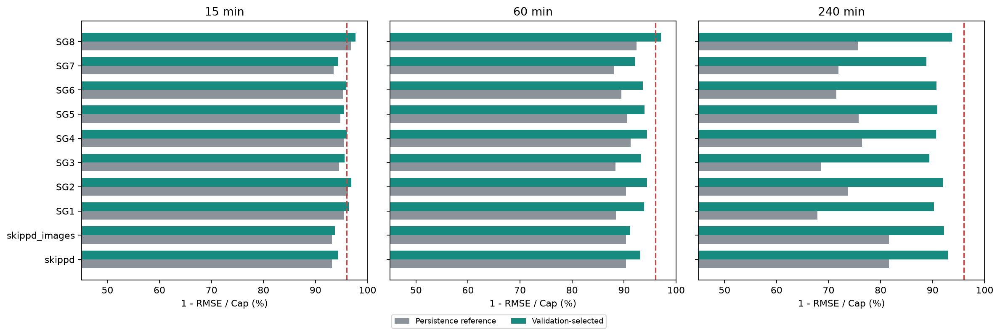
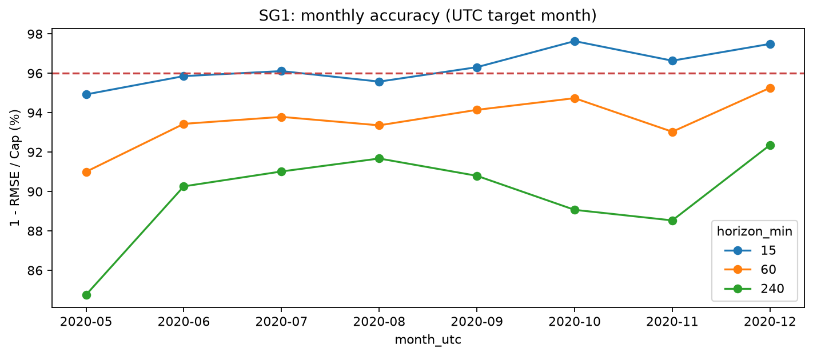
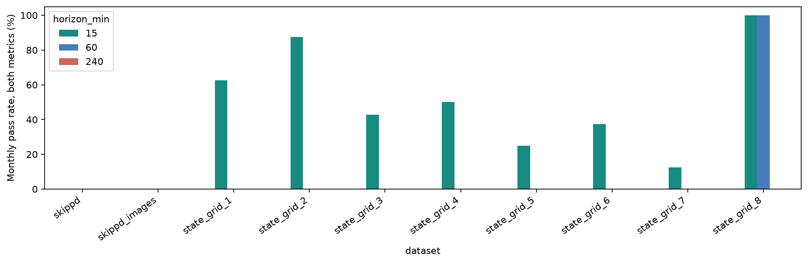
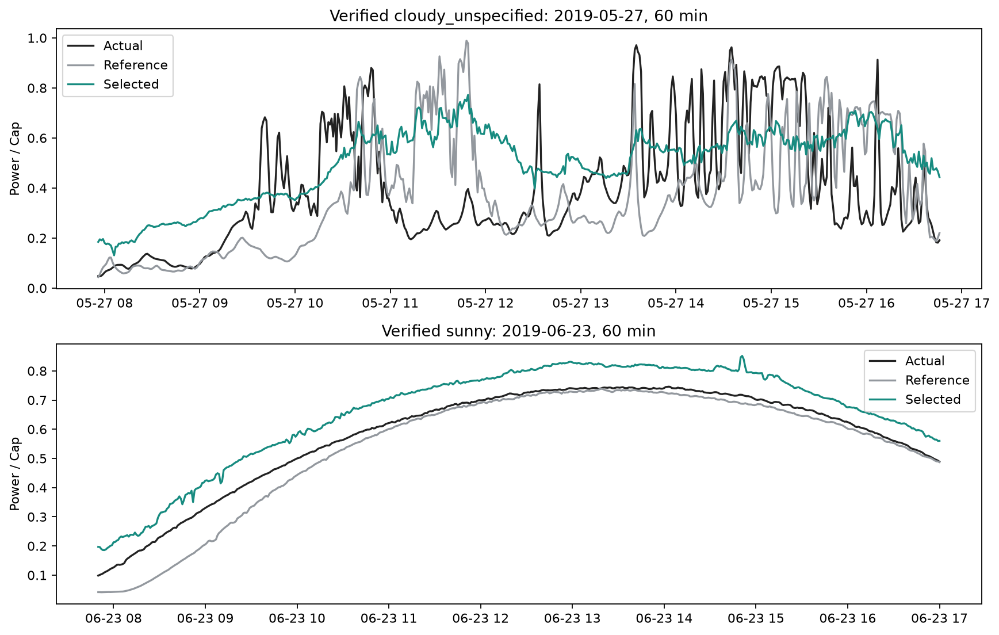
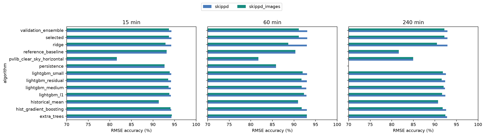
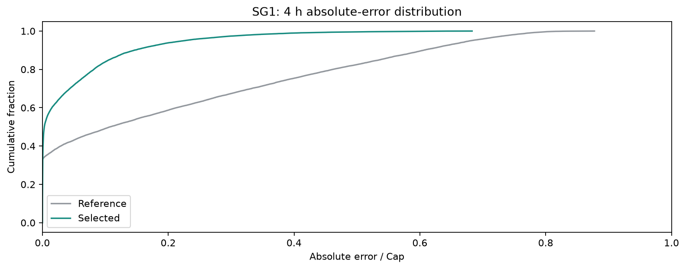
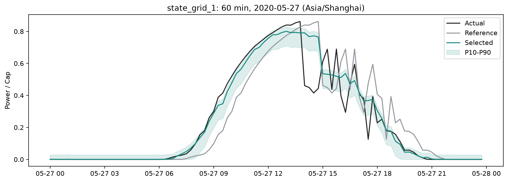
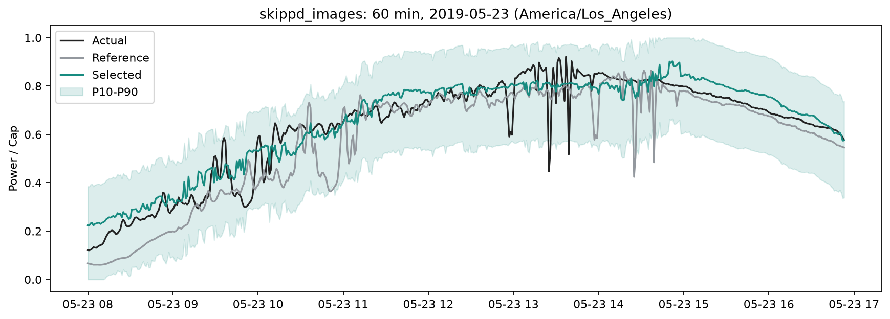

# 光伏预测算法优化实验报告

本报告由已完成实验的配置、预测 CSV 和指标 JSON 自动生成。所有数值均来自真实数据测试，未把未完成训练或已有权重当作已验证结果。

## 1. 结论

共完成 10 组数据/输入方案、每组七种学习算法、三种时距的比较，并在验证集拟合集成。最高单项 RMSE 准确率为 97.723%（state_grid_8，15 min）。
国家电网八站共 24 个站点/时距组合，其中 5 个同时达到两项 96% 门槛。全部三种时距均达到 96% 的电站数为 0/8。以下保留未达标结果。
“准确率”在这里专指 1−MAE/Cap 和 1−RMSE/Cap；不是分类正确率。没有证据说明本轮已经得到全局最优算法，也不能保证在新电站上复现最高值。

八站等权平均（每站先算指标，避免大容量电站支配统计）：

|   horizon_min |   baseline_rmse_accuracy_pct |   mae_accuracy_pct |   rmse_accuracy_pct |   rmse_reduction_pct |
|--------------:|-----------------------------:|-------------------:|--------------------:|---------------------:|
|        15.000 |                       95.256 |             98.390 |              96.049 |               17.392 |
|        60.000 |                       89.865 |             97.275 |              94.097 |               42.292 |
|       240.000 |                       72.701 |             95.340 |              90.825 |               66.300 |

## 2. 固定协议与数据

| dataset       |     cap_kw |   train |   val |   test | train_end                 | val_end                   |
|:--------------|-----------:|--------:|------:|-------:|:--------------------------|:--------------------------|
| skippd        |     30.100 |  125013 | 17385 |  74410 | 2018-09-22T00:00:00-07:00 | 2019-05-23T00:00:00-07:00 |
| skippd_images |     30.100 |  125013 | 17385 |  74410 | 2018-09-22T00:00:00-07:00 | 2019-05-23T00:00:00-07:00 |
| state_grid_1  |  50000.000 |   41969 |  6929 |  21041 | 2020-03-14T00:00:00+08:00 | 2020-05-26T00:00:00+08:00 |
| state_grid_2  | 130000.000 |   41969 |  6929 |  21041 | 2020-03-14T00:00:00+08:00 | 2020-05-26T00:00:00+08:00 |
| state_grid_3  |  30000.000 |   31409 |  5201 |  15761 | 2019-11-25T00:00:00+08:00 | 2020-01-19T00:00:00+08:00 |
| state_grid_4  | 130000.000 |   41902 |  6795 |  20903 | 2020-03-14T00:00:00+08:00 | 2020-05-26T00:00:00+08:00 |
| state_grid_5  | 110000.000 |   41571 |  6929 |  21041 | 2020-03-14T00:00:00+08:00 | 2020-05-26T00:00:00+08:00 |
| state_grid_6  |  35000.000 |   38554 |  5509 |  18879 | 2020-03-14T00:00:00+08:00 | 2020-05-26T00:00:00+08:00 |
| state_grid_7  |  30000.000 |   38552 |  5511 |  18467 | 2020-03-14T00:00:00+08:00 | 2020-05-26T00:00:00+08:00 |
| state_grid_8  |  30000.000 |   41348 |  6754 |  20595 | 2020-03-13T00:00:00+08:00 | 2020-05-25T00:00:00+08:00 |

- seed=42；目标为真正经过 15、60、240 分钟的瞬时/分钟平均功率标签，不是未来窗口能量平均。
- 按有观测记录的本地日期进行 60%/10%/30% 时序切分；训练与验证样本的最长目标不得跨越边界，历史窗口不得跨越缺测间隙。不同站点采样完整性会改变最终比例。
- 天空数据：SKIPP’D，64×64 RGB、过去30个连续分钟；362,022条可用记录。分钟平均功率按分钟结束后可用处理。
- 国家电网：八站15分钟数据、过去64步（16小时）；仅使用发布时刻及以前的功率、TSI/DNI/GHI和温度。这些气象列是实测，不能充当未来 NWP。
- 功率除以固定名义 Cap，辐照度除以1000，温度除以40；Ridge 标准化器仅在训练集拟合。未按测试最大值归一化。仅预测裁剪到[0,Cap]，不裁剪测试真值。
- 验证集前60%的观测日期用于候选/权重选择，后40%日期仅用于残差分位数校准。每个时距独立选型，选型目标是验证 MSE。没有选择测试集最高分的模型。
- 本轮沿用此前已评估过的固定测试集，属于固定留出集的描述性改善证据；要作最终泛化/竞赛达标结论，仍须一份从未接触的新时间段或外部电站数据。
- Cap 暂为数据出处的名义容量；SKIPP’D为30.1kW-DC，实际可用AC容量未提供。因此96%判定是此参考口径下的结果。
- 月度统计按目标时间的UTC月份计算，与现有统一指标函数一致；按天自助统计和示例曲线使用电站本地日期。

## 3. 算法设计与论文借鉴

先建立持久性/Smart Persistence、训练集历史时槽均值、pvlib物理代理基线；随后比较七种模型：Ridge、HistGradientBoosting、ExtraTrees、LightGBM小/中容量、LightGBM持久性残差、LightGBM L1损失。所有超参数见各数据集 search_config.json 和候选矩阵。
输入包含近期功率滞后、均值/标准差/极值、变化率、本地时刻与年周期、训练集时槽均值。天空方案加入晴空功率、晴空指数和太阳位置；气象方案加入历史实测气象。已知未来太阳轨迹、日历、训练集时槽均值可作为目标时刻特征，未来实测功率和气象不能。
集成权重非负且和为1，通过验证集MSE求解，每个时距均允许退回基线。天空图像方案提取RGB统计、红蓝对比、亮区比例、16块空间亮度，以及30分钟均值和15分钟变化；有无图像使用相同样本和模型参数。其思路借鉴SUNSET的功率/天空时序混合输入和云检测的红蓝色差，并非SUNSET或FusionSF官方结构复现。
P10/P50/P90来自独立验证校准日期的残差分位数，加到点预测后裁剪；这是轻量不确定性估计，既不是SkyGPT，也不是带条件覆盖保证的完整概率模型。点指标使用原选定点预测，P50单独保存。
参考文献与代码：

1. Sun等，2019，Short-term solar power forecast with deep learning: Exploring optimal input and output configuration：[论文](https://doi.org/10.1016/j.solener.2019.06.041)、[SUNSET代码](https://github.com/YuchiSun/SUNSET)。
2. Nie等，2023，SKIPP’D数据集：[论文](https://doi.org/10.1016/j.solener.2023.03.043)、[数据/基准代码](https://github.com/yuhao-nie/Stanford-solar-forecasting-dataset)。
3. [天空云检测代码](https://github.com/yuhao-nie/Cloud-dection-in-sky-images)，用于了解红蓝色差与天空条件特征。
4. Ke等，2017，LightGBM：[官方实现和文档](https://github.com/lightgbm-org/LightGBM)。本轮使用官方库，而未复制自定义树实现。
5. [scikit-learn树集成](https://scikit-learn.org/stable/modules/ensemble.html)、[pvlib](https://pvlib-python.readthedocs.io/)。研究下载快照位于research目录；XGBoost资料已查阅，本轮未训练XGBoost，不能列作实验结果。

## 4. 测试结果

| 数据集           |   时距/min |   基线RMSE准确率/% |   优化MAE准确率/% |   优化RMSE准确率/% |   RMSE降低/% | 两项均达96%   |
|:--------------|---------:|--------------:|-------------:|--------------:|-----------:|:----------|
| skippd        |       15 |        93.165 |       97.716 |        94.283 |     16.360 | 否         |
| skippd        |       60 |        90.345 |       96.744 |        93.104 |     28.576 | 否         |
| skippd        |      240 |        81.613 |       96.673 |        92.913 |     61.456 | 否         |
| skippd_images |       15 |        93.165 |       96.263 |        93.719 |      8.110 | 否         |
| skippd_images |       60 |        90.345 |       93.332 |        91.145 |      8.282 | 否         |
| skippd_images |      240 |        81.613 |       95.568 |        92.199 |     57.573 | 否         |
| state_grid_1  |       15 |        95.414 |       98.649 |        96.394 |     21.381 | 是         |
| state_grid_1  |       60 |        88.422 |       97.249 |        93.830 |     46.712 | 否         |
| state_grid_1  |      240 |        67.846 |       95.318 |        90.269 |     69.736 | 否         |
| state_grid_2  |       15 |        96.245 |       98.735 |        96.889 |     17.167 | 是         |
| state_grid_2  |       60 |        90.360 |       97.364 |        94.460 |     42.535 | 否         |
| state_grid_2  |      240 |        73.770 |       95.822 |        92.033 |     69.627 | 否         |
| state_grid_3  |       15 |        94.547 |       98.243 |        95.625 |     19.768 | 否         |
| state_grid_3  |       60 |        88.371 |       97.025 |        93.316 |     42.527 | 否         |
| state_grid_3  |      240 |        68.578 |       94.635 |        89.387 |     66.225 | 否         |
| state_grid_4  |       15 |        95.493 |       98.426 |        96.037 |     12.071 | 是         |
| state_grid_4  |       60 |        91.274 |       97.456 |        94.405 |     35.886 | 否         |
| state_grid_4  |      240 |        76.470 |       95.233 |        90.695 |     60.454 | 否         |
| state_grid_5  |       15 |        94.766 |       98.194 |        95.452 |     13.109 | 否         |
| state_grid_5  |       60 |        90.598 |       97.253 |        93.918 |     35.319 | 否         |
| state_grid_5  |      240 |        75.824 |       95.346 |        90.937 |     62.512 | 否         |
| state_grid_6  |       15 |        95.286 |       98.348 |        95.946 |     14.016 | 否         |
| state_grid_6  |       60 |        89.496 |       97.049 |        93.597 |     39.047 | 否         |
| state_grid_6  |      240 |        71.534 |       95.466 |        90.726 |     67.421 | 否         |
| state_grid_7  |       15 |        93.501 |       97.676 |        94.327 |     12.718 | 否         |
| state_grid_7  |       60 |        88.043 |       96.344 |        92.160 |     34.430 | 否         |
| state_grid_7  |      240 |        71.937 |       94.306 |        88.814 |     60.139 | 否         |
| state_grid_8  |       15 |        96.797 |       98.853 |        97.723 |     28.907 | 是         |
| state_grid_8  |       60 |        92.358 |       98.460 |        97.087 |     61.879 | 是         |
| state_grid_8  |      240 |        75.653 |       96.596 |        93.739 |     74.283 | 否         |



MAE/RMSE的kW原值、样本数和两种归一化指标全部保存在comparison.csv。candidate_matrix.csv列出每种模型及历史均值/物理基线，不据测试矩阵重新选型。图中红线为96%。

## 5. 改善的统计区间

对同一天的预测作为整体重采样，2000次配对日块bootstrap，seed=42。gain_pp是优化相对基线的RMSE准确率百分点增量；95%区间下界大于0支持在本次测试日期上稳定改善。此方法保留日内关联，但未建模多日天气持续性，区间不是未来部署保证。

| dataset       |   horizon_min |   gain_pp |   ci_low_pp |   ci_high_pp |   days |
|:--------------|--------------:|----------:|------------:|-------------:|-------:|
| skippd        |            15 |     1.118 |       0.845 |        1.415 |    156 |
| skippd        |            60 |     2.759 |       2.496 |        3.019 |    156 |
| skippd        |           240 |    11.300 |       9.969 |       12.778 |    156 |
| skippd_images |            15 |     0.554 |       0.120 |        0.992 |    156 |
| skippd_images |            60 |     0.800 |       0.400 |        1.198 |    156 |
| skippd_images |           240 |    10.586 |       9.347 |       11.997 |    156 |
| state_grid_1  |            15 |     0.981 |       0.925 |        1.040 |    220 |
| state_grid_1  |            60 |     5.408 |       5.077 |        5.747 |    220 |
| state_grid_1  |           240 |    22.423 |      20.974 |       23.869 |    220 |
| state_grid_2  |            15 |     0.645 |       0.592 |        0.700 |    220 |
| state_grid_2  |            60 |     4.100 |       3.843 |        4.380 |    220 |
| state_grid_2  |           240 |    18.263 |      17.337 |       19.235 |    220 |
| state_grid_3  |            15 |     1.078 |       0.967 |        1.187 |    165 |
| state_grid_3  |            60 |     4.946 |       4.520 |        5.342 |    165 |
| state_grid_3  |           240 |    20.809 |      19.002 |       22.483 |    165 |
| state_grid_4  |            15 |     0.544 |       0.493 |        0.592 |    220 |
| state_grid_4  |            60 |     3.131 |       2.834 |        3.428 |    220 |
| state_grid_4  |           240 |    14.225 |      12.988 |       15.460 |    220 |
| state_grid_5  |            15 |     0.686 |       0.610 |        0.765 |    220 |
| state_grid_5  |            60 |     3.321 |       3.033 |        3.598 |    220 |
| state_grid_5  |           240 |    15.113 |      13.869 |       16.267 |    220 |
| state_grid_6  |            15 |     0.661 |       0.599 |        0.725 |    217 |
| state_grid_6  |            60 |     4.102 |       3.740 |        4.458 |    217 |
| state_grid_6  |           240 |    19.192 |      17.751 |       20.592 |    217 |
| state_grid_7  |            15 |     0.827 |       0.741 |        0.913 |    217 |
| state_grid_7  |            60 |     4.117 |       3.814 |        4.428 |    217 |
| state_grid_7  |           240 |    16.877 |      15.189 |       18.615 |    217 |
| state_grid_8  |            15 |     0.926 |       0.865 |        0.988 |    217 |
| state_grid_8  |            60 |     4.729 |       4.448 |        5.004 |    217 |
| state_grid_8  |           240 |    18.086 |      16.849 |       19.265 |    217 |

## 6. 白天、月份与天气

整体指标包含原始数据中可用的夜间零功率，另列白天子集；国家电网白天是06:00–19:00本地时钟代理，缺少站点经纬度，不能当作精确太阳高度分类。SKIPP’D源数据仅白天，没有夜间评估。

| dataset       |   horizon_min |     n |   mae_accuracy_pct |   rmse_accuracy_pct |
|:--------------|--------------:|------:|-------------------:|--------------------:|
| skippd        |            15 | 74410 |             97.716 |              94.283 |
| skippd        |            60 | 74410 |             96.744 |              93.104 |
| skippd        |           240 | 74410 |             96.673 |              92.913 |
| skippd_images |            15 | 74410 |             96.263 |              93.719 |
| skippd_images |            60 | 74410 |             93.332 |              91.145 |
| skippd_images |           240 | 74410 |             95.568 |              92.199 |
| state_grid_1  |            15 | 11400 |             97.557 |              95.111 |
| state_grid_1  |            60 | 11397 |             95.025 |              91.629 |
| state_grid_1  |           240 | 11388 |             91.483 |              86.780 |
| state_grid_2  |            15 | 11400 |             97.827 |              95.833 |
| state_grid_2  |            60 | 11397 |             95.426 |              92.553 |
| state_grid_2  |           240 | 11388 |             92.716 |              89.268 |
| state_grid_3  |            15 |  8540 |             96.787 |              94.057 |
| state_grid_3  |            60 |  8537 |             94.579 |              90.922 |
| state_grid_3  |           240 |  8528 |             90.115 |              85.573 |
| state_grid_4  |            15 | 11333 |             97.108 |              94.619 |
| state_grid_4  |            60 | 11332 |             95.348 |              92.402 |
| state_grid_4  |           240 | 11335 |             91.261 |              87.364 |
| state_grid_5  |            15 | 11400 |             96.708 |              93.822 |
| state_grid_5  |            60 | 11397 |             94.995 |              91.738 |
| state_grid_5  |           240 | 11388 |             91.604 |              87.687 |
| state_grid_6  |            15 | 10141 |             96.965 |              94.474 |
| state_grid_6  |            60 | 10134 |             94.568 |              91.268 |
| state_grid_6  |           240 | 10133 |             91.624 |              87.347 |
| state_grid_7  |            15 |  9914 |             95.727 |              92.262 |
| state_grid_7  |            60 |  9909 |             93.264 |              89.303 |
| state_grid_7  |           240 |  9919 |             89.515 |              84.743 |
| state_grid_8  |            15 | 11162 |             97.905 |              96.907 |
| state_grid_8  |            60 | 11153 |             97.181 |              96.042 |
| state_grid_8  |           240 | 11128 |             93.943 |              91.501 |





天气只使用可核实的来源标签。未提供的天气保留unknown；来源仅标注cloudy时，不把它擅自分成多云和阴天。weather.csv保留晴天/多云/阴天无标签组的n=0，不能据此声称完成三类天气全面验证。

| dataset       |   horizon_min | weather            |     n |   mae_accuracy_pct |   rmse_accuracy_pct |
|:--------------|--------------:|:-------------------|------:|-------------------:|--------------------:|
| skippd        |            15 | cloudy_unspecified |  1920 |             88.581 |              83.921 |
| skippd        |            15 | sunny              |  1459 |             99.482 |              99.341 |
| skippd        |            15 | unknown            | 71031 |             97.927 |              94.781 |
| skippd        |            60 | cloudy_unspecified |  1920 |             85.345 |              81.152 |
| skippd        |            60 | sunny              |  1459 |             99.120 |              98.877 |
| skippd        |            60 | unknown            | 71031 |             97.003 |              93.661 |
| skippd        |           240 | cloudy_unspecified |  1920 |             85.571 |              79.648 |
| skippd        |           240 | sunny              |  1459 |             99.004 |              98.688 |
| skippd        |           240 | unknown            | 71031 |             96.925 |              93.567 |
| skippd_images |            15 | cloudy_unspecified |  1920 |             87.727 |              83.550 |
| skippd_images |            15 | sunny              |  1459 |             97.489 |              97.191 |
| skippd_images |            15 | unknown            | 71031 |             96.469 |              94.182 |
| skippd_images |            60 | cloudy_unspecified |  1920 |             84.354 |              80.598 |
| skippd_images |            60 | sunny              |  1459 |             94.200 |              93.480 |
| skippd_images |            60 | unknown            | 71031 |             93.556 |              91.568 |
| skippd_images |           240 | cloudy_unspecified |  1920 |             85.617 |              80.189 |
| skippd_images |           240 | sunny              |  1459 |             97.482 |              96.903 |
| skippd_images |           240 | unknown            | 71031 |             95.798 |              92.724 |



天气曲线使用每种已核实标签的首个测试日期，缺少标签的多云/阴天组无法绘制可靠曲线。

## 7. 图像消融、误差与预测曲线



消融中每种模型的测试差异可以比较图像输入的贡献；分别验证选出的两个集成还会改变权重，不能把集成差异全部归因于图像。若某些时距图像降低测试效果，仍照实保留。







曲线使用按有效覆盖度选出的首个完整测试日期，不根据预测误差挑选；展示60分钟预测。阴影为校准残差区间。

## 8. 概率输出验证

| dataset       |   horizon_min |   coverage_pct |   width_kw |   p10_pinball_kw |   p50_pinball_kw |   p90_pinball_kw |
|:--------------|--------------:|---------------:|-----------:|-----------------:|-----------------:|-----------------:|
| skippd        |            15 |         94.352 |      6.336 |            0.464 |            0.349 |            0.330 |
| skippd        |            60 |         96.793 |     11.855 |            0.748 |            0.492 |            0.524 |
| skippd        |           240 |         98.922 |     15.531 |            1.033 |            0.516 |            0.536 |
| skippd_images |            15 |         94.947 |      6.912 |            0.410 |            0.540 |            0.430 |
| skippd_images |            60 |         96.550 |     11.979 |            0.619 |            1.046 |            0.667 |
| skippd_images |           240 |         98.766 |     15.676 |            0.961 |            0.733 |            0.627 |
| state_grid_1  |            15 |         83.352 |   1371.309 |          246.452 |          337.304 |          288.141 |
| state_grid_1  |            60 |         81.408 |   3466.450 |          414.725 |          686.419 |          529.085 |
| state_grid_1  |           240 |         80.742 |   7536.770 |          687.858 |         1167.115 |          766.291 |
| state_grid_2  |            15 |         82.834 |   3977.449 |          574.172 |          821.551 |          678.939 |
| state_grid_2  |            60 |         82.910 |  10707.319 |         1065.295 |         1711.938 |         1321.372 |
| state_grid_2  |           240 |         83.746 |  19562.523 |         1539.404 |         2715.541 |         1968.640 |
| state_grid_3  |            15 |         74.875 |    652.127 |          201.156 |          263.400 |          241.619 |
| state_grid_3  |            60 |         76.252 |   1539.917 |          321.488 |          446.290 |          366.520 |
| state_grid_3  |           240 |         79.843 |   4395.387 |          561.084 |          804.687 |          556.941 |
| state_grid_4  |            15 |         82.792 |   4815.821 |          720.341 |         1023.382 |          886.563 |
| state_grid_4  |            60 |         82.758 |   9582.386 |         1086.823 |         1651.077 |         1325.188 |
| state_grid_4  |           240 |         81.314 |  21557.713 |         2054.185 |         3097.739 |         2455.379 |
| state_grid_5  |            15 |         82.515 |   4685.433 |          741.935 |          992.625 |          858.445 |
| state_grid_5  |            60 |         81.455 |   7420.260 |         1021.279 |         1507.773 |         1194.630 |
| state_grid_5  |           240 |         80.605 |  13882.034 |         1512.297 |         2539.785 |         1926.425 |
| state_grid_6  |            15 |         82.981 |   1371.602 |          206.294 |          288.658 |          243.009 |
| state_grid_6  |            60 |         80.762 |   2394.711 |          344.120 |          516.176 |          396.123 |
| state_grid_6  |           240 |         79.766 |   3911.223 |          566.882 |          793.349 |          541.549 |
| state_grid_7  |            15 |         84.746 |   1817.563 |          218.445 |          347.248 |          311.608 |
| state_grid_7  |            60 |         82.239 |   2721.603 |          303.510 |          547.817 |          451.540 |
| state_grid_7  |           240 |         79.742 |   4363.100 |          507.604 |          851.189 |          583.125 |
| state_grid_8  |            15 |         81.758 |    989.977 |           96.769 |          171.066 |          135.676 |
| state_grid_8  |            60 |         81.617 |   1359.372 |          117.484 |          229.994 |          174.213 |
| state_grid_8  |           240 |         81.631 |   2788.322 |          260.457 |          505.771 |          352.405 |

P10–P90名义覆盖80%，实际覆盖与区间宽度同时报告。覆盖偏离80%表明校准分布与测试分布存在变化；不能只提供窄区间而不检验覆盖。

## 9. 可复现交付与运行

所有候选在本地runs/optimization_v2保留配置、checkpoint、预测CSV、指标JSON和源码版本。报告evidence目录另附选型、候选指标和配置，精选权重随仓库交付，完整预测CSV留在本地。训练源数据按manifest中的SHA256固定，不把原始数据上传GitHub。验证集选型文件先于测试指标保存。
本轮运行期间补了HDF5排序读取、缓存一致性校验、输出目录参数和报告/推理接口；候选模型、参数、选型方法保持固定。旧批次code_version记录的是当时磁盘源码树哈希，不能把它当作解释器内存中所有已加载源码的精确快照；已完善后续运行的loaded_algorithm_sha256及training_optimize.py保存。当前交付源码与已验证权重的预测行为进行了重新加载核对。
精选权重位于product/backend/data/model_releases/optimization_v2；每个站点附JSON清单、特征顺序、历史均值状态、集成权重、校准残差和SHA256。已从序列化文件重新加载，并验证跨越整个测试期的最多1000个确定性样本能重现预测。

| dataset       | checkpoint           |   size_mb |
|:--------------|:---------------------|----------:|
| skippd        | skippd.joblib        |    61.792 |
| skippd_images | skippd_images.joblib |    63.809 |
| state_grid_1  | state_grid_1.joblib  |    19.795 |
| state_grid_2  | state_grid_2.joblib  |    24.225 |
| state_grid_3  | state_grid_3.joblib  |    16.880 |
| state_grid_4  | state_grid_4.joblib  |    19.668 |
| state_grid_5  | state_grid_5.joblib  |    19.321 |
| state_grid_6  | state_grid_6.joblib  |    18.478 |
| state_grid_7  | state_grid_7.joblib  |    18.342 |
| state_grid_8  | state_grid_8.joblib  |    19.275 |

```bash
pip install -r experiments/requirements-optimization.txt
python -m experiments.optimize --dataset all --output-root runs/optimization_v2
python -m experiments.optimize --dataset skippd --images --output-root runs/optimization_v2
python -m experiments.report_optimization
python -m pytest experiments/tests/test_optimization.py -q
```

macOS缺少libomp时可在命令前加DYLD_LIBRARY_PATH指向已安装torch/lib。依赖版本在requirements及运行配置中保存。预处理数据缺失时先按EXPERIMENT_REPORT.md执行prepare。源码/参数变化时须使用新输出位置，不能混用旧预测缓存。
推理接口为experiments.predict_optimized.load_release及predict_feature_matrices，输入严格匹配有序特征矩阵与归一化基线，返回kW点预测和三分位数。生产特征构建仍需对接站点实时数据和发布时刻可用性，尚未自动启用后端在线预测。
验证：后端170项测试通过；优化测试覆盖未来观测不可改变发布时刻特征、精确时距/缺测过滤、凸集成及权重推理接口；每组精选模型重载检查覆盖1000个确定性测试样本。后端滚动测试固定中午并提供合法SOC，避免最后时槽和模拟SOC扰动干扰其创建修正的断言。

## 10. 未完成项与下一阶段优先级

本次没有完成SUNSET官方完整训练、原MobileNetV3+ConvLSTM+attention+fusion的合规完整重训、ConvNeXt/Swin/VMamba/Spatial Mamba及FusionSF/SkyGPT的全部训练比较。此前AMPDNet仅训练两轮，属于不完整训练，不列入本轮成熟模型排名。不能将旧权重的测试集选型或按各分区最大值缩放结果用于达标证明。
1. 优先获取发布时刻可追溯的NWP预报和真实可用Cap；这对1小时/4小时预测尤其关键。需要用新的未接触测试期比较，不能用未来实测气象代替。
2. 在GPU上用同样固定协议完成SUNSET与原融合模型基准，再逐个做骨干替换、时序模块及融合消融；只有验证集稳定获益才保留。
3. 以本轮图像消融为依据，研究云运动/太阳遮挡特征与多时刻图像编码，并对少量可靠天气标签进行人工补充或独立标注。
4. 概率模型可升级为条件分位数树/网络与滚动校准，必须保留分位数损失、覆盖率、区间宽度以及新时间段验证。
5. 最后做新电站迁移、不同季节/坡向测试和服务延迟评估；本轮不做电价预测。
